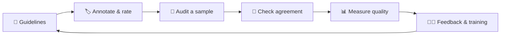

<p align="center">
  <a href="https://afra-ozi.github.io/afra-ozi/"></a>
</p>

<p align="center">
  <a href="https://afra-ozi.github.io/afra-ozi/"></a>
  <a href="https://www.linkedin.com/in/afra-firdaus-46a99b286"></a>
  <a href="mailto:afraomairgamer@gmail.com"></a>
  
</p>

<p align="center">
  
  
  
  
</p>

---

## `$ whoami`

```python
# afra.py
from dataclasses import dataclass


@dataclass(frozen=True)
class Afra:
    name: str = "Afra Firdaus Momin"
    role: str = "AI Data Quality Specialist"
    based_in: str = "Malegaon, Maharashtra, India (remote)"
    years_in_data_qa: int = 10
    education: str = "MCA, Savitribai Phule Pune University"
    certifications: tuple = (
        "Generative AI: Prompt Engineering Basics (IBM, 2023)",
        "Oracle DBA & PL/SQL (2016)",
    )
    recent_work: tuple = (
        "evaluated and compared LLM responses",
        "rated search, ads, maps & social content",
        "annotated text, image & audio training data",
    )
    stack: tuple = ("Python", "SQL", "Oracle PL/SQL", "SQLite", "Git", "Excel")

    def mission(self) -> str:
        return "Better data for better AI."


if __name__ == "__main__":
    me = Afra()
    print(f"{me.name} | {me.role}")
    print(me.mission())
```

I help make AI systems more accurate by producing and checking the data they learn from. I have **10+ years** in research,
data validation and quality assurance, and most recently, at **Appen**, I rated search results and ads, evaluated **LLM chatbot responses** and
annotated training data. The tools below are the scripts I wish every labeling team had: small, tested and
easy to read.

## 🔁 My quality loop, and the tool for each step



| Step | What I do | Tool in this profile |
|---|---|---|
| 📘 Guidelines | Turn a rulebook into prompts and checklists | [prompt-engineering-playbook](https://github.com/afra-ozi/prompt-engineering-playbook) |
| 🏷️ Annotate & rate | Score LLM answers against a rubric | [llm-eval-scorer](https://github.com/afra-ozi/llm-eval-scorer) |
| 🎯 Audit a sample | Pick a fair, reproducible QA sample | [qa-audit-sampler](https://github.com/afra-ozi/qa-audit-sampler) |
| 🤝 Check agreement | Cohen's & Fleiss' kappa, items to adjudicate | [annotation-agreement](https://github.com/afra-ozi/annotation-agreement) |
| 📊 Measure quality | NDCG, MRR, validation rules, SQL checks | [search-relevance-metrics](https://github.com/afra-ozi/search-relevance-metrics), [data-quality-checker](https://github.com/afra-ozi/data-quality-checker), [sql-data-validation](https://github.com/afra-ozi/sql-data-validation) |
| 🧑‍🏫 Feedback & training | Productivity reports and a guideline quiz | [annotator-productivity-report](https://github.com/afra-ozi/annotator-productivity-report), [guideline-quiz](https://github.com/afra-ozi/guideline-quiz) |

## 🚀 Projects

Every code project is **standard-library Python 3.9+ with unit tests, sample data and a README**: clone it and run it.

| Project | What it does | Tech |
|---|---|---|
| 🏷️ [**annotation-agreement**](https://github.com/afra-ozi/annotation-agreement) | Inter-annotator agreement: Cohen's & Fleiss' kappa, plus an adjudication list | Python |
| 🤖 [**llm-eval-scorer**](https://github.com/afra-ozi/llm-eval-scorer) | Weighted rubric scoring for LLM responses + side-by-side win rates | Python |
| 🔍 [**search-relevance-metrics**](https://github.com/afra-ozi/search-relevance-metrics) | NDCG@k, Precision@k & MRR from human relevance ratings | Python |
| ✅ [**data-quality-checker**](https://github.com/afra-ozi/data-quality-checker) | Rule-based CSV validation: required, unique, regex, allowed values, ranges | Python · JSON |
| 🗄️ [**sql-data-validation**](https://github.com/afra-ozi/sql-data-validation) | SQL data-quality checks with a PASS/FAIL runner | SQL · SQLite |
| 🧩 [**prompt-engineering-playbook**](https://github.com/afra-ozi/prompt-engineering-playbook) | Prompt patterns, rewrites & an LLM evaluation checklist | Markdown |
| 🎯 [**qa-audit-sampler**](https://github.com/afra-ozi/qa-audit-sampler) | Stratified, reproducible QA audit samples by annotator & label | Python CLI |
| 📊 [**annotator-productivity-report**](https://github.com/afra-ozi/annotator-productivity-report) | Tasks/hour, handling time & QA pass rate, with check-in flags | Python CLI |
| 📝 [**guideline-quiz**](https://github.com/afra-ozi/guideline-quiz) | Terminal quiz that trains raters on guideline edge cases | Python CLI · JSON |

### Try one in 10 seconds

```bash
git clone https://github.com/afra-ozi/guideline-quiz.git
cd guideline-quiz
python quiz.py questions.json --answers sample_answers.txt
```

```text
Score: 8/10 (80%), PASS (pass mark 80%)

By topic:
  llm-rating     2/3
  annotation     2/3
  relevance      3/3
  safety         1/1
```

## 🛠️ Skills & tools

**Code & data**


-ED8B00?style=for-the-badge&logo=openjdk&logoColor=white)
-512BD4?style=for-the-badge&logo=dotnet&logoColor=white)

**AI data & quality**


## 💼 Experience

<details open>
<summary><b>Search Engine Evaluator & AI Data Specialist</b> · Appen (Remote) · 2024 – 2026</summary>

- Rated the relevance and quality of search results against detailed rater guidelines
- Evaluated and compared LLM chatbot responses for accuracy, helpfulness and safety; wrote prompts and feedback for model training
- Assessed ads relevance, maps/local listings and social media content for quality and policy compliance
- Annotated text, image and audio data for machine-learning training sets

</details>

<details>
<summary><b>Quality Analyst</b> · Datamatics Business Solutions Ltd · Jul 2019 – 2024</summary>

- Data annotation and labeling with a focus on accuracy and consistency
- Applied complex client guidelines to categorization, labeling and quality review

</details>

<details>
<summary><b>Senior Research Associate</b> · Datamatics Business Solutions Ltd · Apr 2015 – Jun 2017</summary>

- Analyzed incoming projects against client requirements to estimate effort and turnaround time
- Maintained project tracking and resource utilization reports for management

</details>

<details>
<summary><b>Research Associate</b> · Datamatics Business Solutions Ltd · Apr 2012 – Apr 2015</summary>

- Researched and validated entity data from search engines and secondary sources
- Ran quality checks on other researchers' work, allocated work across the team and trained new researchers
- Formatted and cleaned data in MS Excel; managed backups, updates and data retrieval

</details>

## 🎓 Education & certifications

| | |
|---|---|
| 🎓 **MCA**, Master of Computer Applications (2020) | Dr. B.V. Hiray College of Management & Research Center, Savitribai Phule Pune University |
| 🎓 **B.Sc. Information Technology** | Akbar Peerbhoy College |
| 📜 **Generative AI: Prompt Engineering Basics** (Feb 2023) | IBM via Coursera |
| 📜 **Oracle DBA & PL/SQL** (2016) | Karrox Technology |

## 📫 Let's connect

Open to **remote roles in AI training data, LLM evaluation, search/ads quality rating and data QA**.

- 📧 [afraomairgamer@gmail.com](mailto:afraomairgamer@gmail.com)
- 💼 [LinkedIn](https://www.linkedin.com/in/afra-firdaus-46a99b286)
- 🌐 [afra-ozi.github.io/afra-ozi](https://afra-ozi.github.io/afra-ozi/)


